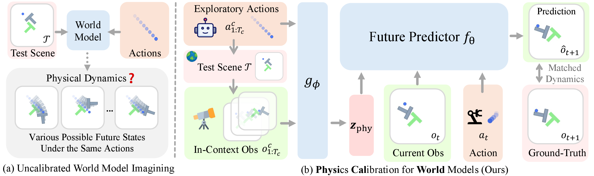

## PhysiCalWorld: In-Context Physics Calibration for World Models

<p align="center">
  <a href="https://devinluo27.github.io/">Yunhao Luo</a><sup>*</sup>,
  <a href="https://wthe2004.github.io/">Wentao He</a><sup>*</sup>,
  <a href="https://yinpeidai.github.io/">Yinpei Dai</a>,
  <a href="https://hyelinnam.github.io/">Hyelin Nam</a>,
  <a href="https://scholar.google.com/citations?user=lT9MVHsAAAAJ">Hongze Fu</a>,
  <br>
  <a href="https://web.eecs.umich.edu/~chaijy/">Joyce Chai</a>,
  <a href="https://www.mmintlab.com/people/nima-fazeli/">Nima Fazeli</a><sup>†</sup>,
  <a href="https://jjparkcv.github.io/">Jeong Joon Park</a><sup>†</sup>
  <br>
  University of Michigan
  <br>
  <sup>*</sup>Equal contribution, <sup>†</sup>Equal advising
</p>

<p align="center">
   <b>[ <a href="https://arxiv.org/abs/2610.30125">Paper</a> | <a href="https://huggingface.co/physical-world">Checkpoints &amp; Data</a> | <a href="https://physical-world.github.io/">Website</a> ]</b>
</p>

<br>

<div align="center">
  
</div>

<div align="justify">

PhysiCalWorld calibrates action-conditioned world models to the actual dynamics of a test scene via prompting with in-context interaction. In (a), current visual observation alone cannot identify the physical dynamics of the test scene $`\mathcal{T}`$, forcing the world model to guess among multiple potential future states. In (b), starting from the top left, exploratory actions $`a_{1:T_c}^c`$ are first executed in the test scene $`\mathcal{T}`$, yielding observations $`o_{1:T_c}^c`$. The context encoder $`g_\phi`$ then extracts physics information from this obs-action sequence and compresses it into a physics descriptor token $`\mathbf{z}_{\text{phy}}`$. Conditioned on $`\mathbf{z}_{\text{phy}}`$, the world model is able to generate future prediction $`\hat{o}_{t+1}`$ consistent with the test scene’s dynamics.

</div>

## Using the code

**Installation:**
```bash
pixi install --locked
pixi run check-imports
```

Frozen DINOv2 weights are downloaded automatically on first use. For headless GPU rendering:
```bash
export MUJOCO_GL=egl PYOPENGL_PLATFORM=egl SDL_VIDEODRIVER=dummy
```

**Checkpoints:**
Download pretrained checkpoints from [Hugging Face](https://huggingface.co/physical-world):
```bash
pixi run hf download physical-world/PhysiCal-World --local-dir checkpoints
```

## Data

Download pre-collected datasets from [Hugging Face](https://huggingface.co/physical-world) and extract:
```bash
pixi run hf download physical-world/PhysiCal-datasets --repo-type dataset --local-dir data
bash data/untar_from_hf.sh
```

To collect datasets from scratch:
```bash
pixi run python -m env.collect.pusht --config-name pusht
```
Replace `pusht` with `reacher`, `beerpong`, or `fetch_slide` (append `_smoke` for a fast test run).

## Training

Training configurations are managed via Hydra under `conf/`. Checkpoints and resolved configurations are saved under `logs/`.

### DINO-WM Family

#### PhysiCalWorld: In-Context Physics World Models (Ours)

PhysiCalWorld models are trained end-to-end using only the latent prediction loss, without ground-truth physics labels:

```bash
# Push-T (default)
pixi run python launch.py --config-name train_pusht_context
```

To train on other environments, change the config to `train_reacher_context`, `train_fetch_slide_context`, or `train_beerpong_context`.

#### Estimated Physics (Two-Stage Baseline)

Unlike PhysiCalWorld, which infers physics implicitly via in-context prompt tokens, **Estimated Physics** decouples system identification into an explicit two-stage pipeline:
1. **Stage 1 (Privileged Physics World Model)**: An action-conditioned world model trained with ground-truth physical parameters (e.g., mass, friction, damping).
2. **Stage 2 (Physical Parameter Estimator)**: A standalone regression model supervised by ground-truth physics labels that predicts physical parameters from context clips.
3. **Inference Pipeline**: During test-time evaluation, the trained Estimator infers physical parameters on the fly, feeding them directly into the Privileged Physics world model (`--conditioning estimated`).

```bash
# Step 1: Train privileged physics world model (Push-T)
pixi run python launch.py --config-name train_privileged_physics

# Step 2: Train physical parameter estimator (Push-T)
pixi run python estimator_launch.py --config-name estimator
```

To train on other environments:
- **Step 1 (World Model)**: replace `--config-name train_privileged_physics` with `train_reacher_privileged_physics`, `train_fetch_slide_privileged_physics`, or `train_beerpong_privileged_physics`.
- **Step 2 (Estimator)**: replace `--config-name estimator` with `estimator_reacher`, `estimator_fetch_slide`, or `estimator_beerpong`.

#### Other Baselines

```bash
# Trajectory-Straightened World Model (TSWM)
pixi run python launch.py --config-name train_tswm

# DINO-WM (no physics conditioning)
pixi run python launch.py 'assets@_global_=pusht_vanilla' training=pusht

# Long History Baseline (concatenates extended observation frames)
pixi run python launch.py 'assets@_global_=pusht_long_history' training=pusht_long_history

# Prefix Context Baseline (prepends context frames into sequence input)
pixi run python launch.py --config-name train_prefix_context
```

To train baselines on other environments, replace `pusht` with the target environment name (e.g., `train_reacher_tswm`, `'assets@_global_=reacher_vanilla' training=reacher`).

### LeWM Family

```bash
# LeWM baseline (Push-T)
pixi run python lewm_launch.py assets=pusht_lewm

# LeWM + In-Context conditioning (Push-T)
pixi run python lewm_launch.py assets=pusht_lewm_context

# Auxiliary: Train the LeWM Image Decoder (with frozen JEPA weights)
pixi run python lewm_decoder_launch.py assets=pusht_lewm
```

To train on other environments, change `assets=pusht_lewm` to `reacher_lewm`, `fetch_slide_lewm`, or `beerpong_tc_lewm`.

*Note: The decoder script loads the released LeWM model and architecture config from `checkpoints/<environment>/lewm/`. To use your own trained model, override `assets.checkpoint` and `assets.checkpoint_config`.*

## Prediction and Planning

`--workflow nonplanning` evaluates next-frame prediction and open-loop rollout (PSNR, SSIM, LPIPS, IoU); `--workflow planning` reports the success rate over 75 planning tasks, each defined by a start image and a goal image.

### DINO-WM Family
```bash
pixi run python dinowm_based_evaluate.py --environment pusht --conditioning context --workflow nonplanning
pixi run python dinowm_based_evaluate.py --environment pusht --conditioning context --workflow planning
```

**Options:**
- `--environment`: `pusht` (default), `reacher`, `fetch_slide`, `beerpong`
- `--conditioning`: `privileged_physics` (default), `context` (Ours), `estimated`, `prefix_context`, `tswm` (TS-WM), `vanilla`
- `--inspection`: Fast 1-episode smoke test with reduced search budget
- `--num-targets`: Number of evaluation episodes (default: 75, seed: 42)
- `--target-manifest` / `--ctx-manifest`: Replay exact episode selections from a JSON manifest (the paper's are in [`reproduce/`](reproduce))

Results, metrics (`*.json`), and rollout videos are saved under `logs/<conditioning>/<timestamp>/`.

#### Long History
Long History use different launch scripts `eval_pusht.py` (Push-T) and `eval_visual.py` (Reacher, FetchSlide, BeerPong):
```bash
pixi run python eval_pusht.py --config-name eval_pusht_long_history phase=nonplanning
pixi run python eval_visual.py --config-name eval_reacher_long_history phase=planning
```
Use `eval_<environment>_long_history` and set `phase=nonplanning|planning`. Results are saved under `logs/<timestamp>/`.

### LeWM Family
```bash
pixi run python lewm_based_evaluate.py --environment pusht --method lewm_context --workflow nonplanning
```
Use `--method lewm` or `lewm_context` (`tc_lewm` or `tc_lewm_context` on BeerPong) and `--workflow nonplanning|planning`. Results are saved under `logs/<method>/<environment>/<timestamp>/`.

### Reproducing Paper Results
Evaluation samples its targets and context clips from a seed by default. To evaluate on the paper's targets and contexts, pass the manifests in [`reproduce/`](reproduce); see [`reproduce/README.md`](reproduce/README.md).

### Your Own Checkpoints
Evaluation reads checkpoints through `conf/assets/<environment>_<method>.yaml`. To evaluate your own model, point `checkpoint` and `checkpoint_config` in that file to your checkpoint and its saved model configuration; for a run trained with `launch.py`, these are `logs/<run>/model_<epoch>.pth` and `logs/<run>/model_config.yaml`.

## Analysis

Scripts and notebooks to reproduce paper figures. The plotting notebooks for physics extrapolation, descriptor similarity and planning success thresholds read the paper's summary data in [`analysis/paper_data/`](analysis/paper_data) by default; to plot your own results, point them to the outputs of the commands below.

- **Physics Extrapolation**:
  ```bash
  pixi run python -m analysis.reacher_extrapolation --config conf/analysis/reacher_extrapolation.json --output logs/extrapolation
  pixi run python -m analysis.reacher_extrapolation --summarize --results logs/extrapolation --output logs/extrapolation_summary
  ```
  Plot via [`analysis/reacher_extrapolation.ipynb`](analysis/reacher_extrapolation.ipynb).

- **Descriptor Similarity**:
  ```bash
  pixi run python -m analysis.context_similarity --output logs/similarity
  ```
  Uses the collection in `data/analysis/pusht_context`; to collect a new one, run `pixi run python -m env.collect.pusht_context` and pass `--collection logs/collection/pusht_context`. Plot via [`analysis/context_similarity.ipynb`](analysis/context_similarity.ipynb).

- **Planning Success Thresholds**: You need to collect the `planning/0_result_planning.json` of each planning run into one directory, with one folder per environment and method (method names as in `conf/analysis/success_thresholds.json`; all nine methods for Reacher and FetchSlide):
  ```
  <results>/reacher/context/0_result_planning.json
  <results>/fetch_slide/vanilla/0_result_planning.json
  ...
  ```
  The script then computes each method's planning success rate across error tolerances (0–30° for Reacher, 0–10 cm for FetchSlide) and writes the curves to `curves.json`:
  ```bash
  pixi run python -m analysis.success_thresholds --results <results> --output logs/thresholds
  ```
  Plot via [`analysis/success_thresholds.ipynb`](analysis/success_thresholds.ipynb).

- **Inference & Planning Efficiency**:
  ```bash
  pixi run python -m analysis.inference_efficiency --output logs/inference
  pixi run python -m analysis.inference_efficiency --planning --config conf/analysis/planning_efficiency.json --output logs/planning
  ```
  Plot via [`analysis/inference_efficiency.ipynb`](analysis/inference_efficiency.ipynb).

Dataset browser: open [`analysis/dataset_preview.ipynb`](analysis/dataset_preview.ipynb).


## Citation

```bibtex

```

